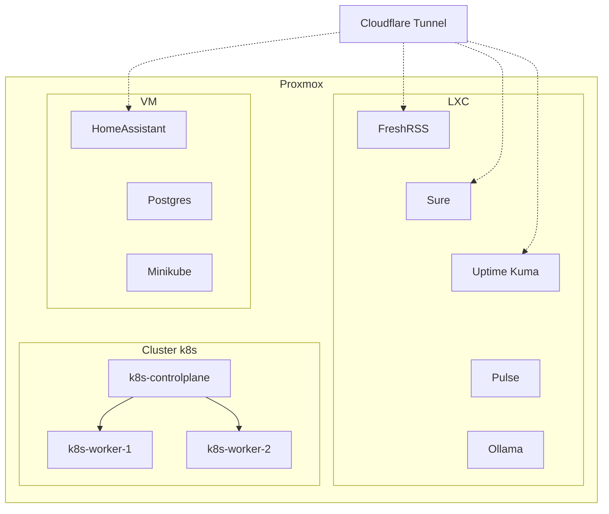

# 🏠 Homelab

> *I hear and I forget. I see and I remember. I do and I understand.* — Xunzi

My homelab is a playground for learning and experimentation.

I run a **hybrid setup** on top of **Proxmox**: some services live on **Kubernetes**, while others run as **VMs** or **LXC containers**, depending on what makes the most sense (simplicity, reliability, resource usage, or hardware access).

This setup pushes me to think critically about system design, backup strategies, security, scalability, and the overall ease of deployment and maintenance.

## ⚙️ Components and tools

### Platform
- Virtualization: **Proxmox**
- Workloads: **Kubernetes**, **VMs**, **LXC containers**

### Services
- **Home Assistant** — home automation platform
- **Sure** — personal finance & budgeting
- **FreshRSS** — RSS aggregator for reading and filtering feeds
- **Uptime Kuma** — uptime monitoring and alerting
- **Pulse** — resource monitoring (CPU, RAM, disk/storage) for my homelab
- **Ollama** — local LLM runtime for experiments
- **Postgres** — sandbox database (dev/test)
- **Minikube** — local Kubernetes sandbox for quick testing

### Kubernetes (when it fits)
- Load Balancer (L2 ARP): **MetalLB**
- Networking: **Cilium**
- Ingress controller (L7 HTTP): **Traefik**
- GitOps: **FluxCD** (GitHub)
